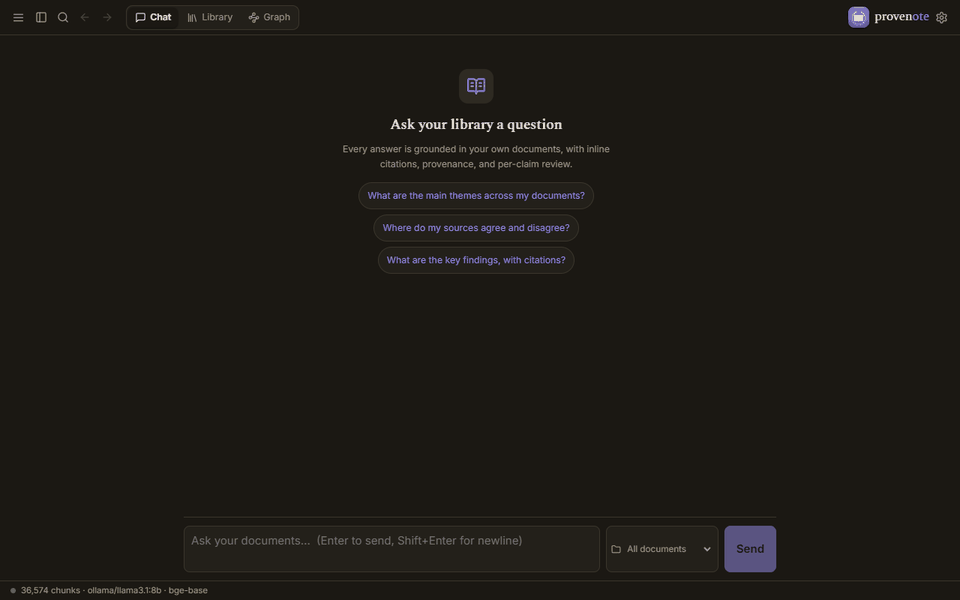
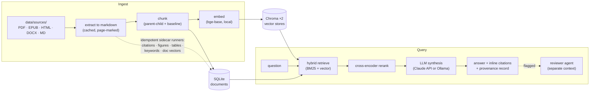

# Provenote

Ask questions of your own papers and books, and get answers you can check. Provenote is a desktop
app for one person and their library: a researcher, student or analyst who needs to know where a
statement came from before reusing it. It reads PDF, EPUB, DOCX, HTML, Markdown and more, and
your library stays on your disk.



## What sets it apart

- **A citation opens the page.** Each cited claim names the page its passage came from, and one
  click shows that page of the PDF as it was printed, beside the document. *In context* shows the
  passage highlighted in the text around it instead.
- **What your sources say is kept apart from what the model infers.** An answer shows the
  retrieved passages word for word, with their source, page and relevance score, and next to them
  the model's synthesis, labelled as interpretation. A claim that cites nothing, or cites a weak
  passage, is flagged for you to accept, reject or edit, and a separate reviewer can re-grade a
  flagged answer against the passages. The flags come from retrieval scores: they tell you where
  to look, they do not certify a claim ([how answers work](docs/how-answers-work.md)).
- **Your documents can stay on your computer.** With a local model through
  [Ollama](https://ollama.com), none of your text leaves the machine: the embedding and reranking
  models run locally, and the installer bundles them. With the Claude API, the question and the
  passages retrieved for it are sent to write the answer.

## One result, and how far it goes

On a benchmark anyone can rebuild (10 hand-checked questions over 10 arXiv papers pinned by
checksum, 5 trials, Claude Haiku 4.5), answers contained **93% of the facts each one must hold**
(`contains_all` 0.932 ± 0.014), and retrieval found the right paper in every case. Ten papers are
too few for that retrieval score to rank anything, so it shows only that nothing regressed. The
method, the caveats and the other measurements are in [Benchmarks](#benchmarks) and
[`evals/`](evals/README.md).

## Quick start

**Windows installer:** download `Provenote_<version>_x64-setup.exe` from the
[latest release](https://github.com/ldele/doc_assistant/releases/latest) and run it. It is not
code-signed, so SmartScreen will warn. It is a ~1.6 GB download because the embedding and
re-ranking models are bundled, and it runs fully offline with a local [Ollama](https://ollama.com).
Settings → Updates can tell you when a newer one is published; it never installs anything for you.

**From source:**

```bash
uv sync --extra cu130 --extra dev        # or --extra cpu on a GPU-less box
uv run python -m scripts.download_corpus --demo   # no corpus yet? 28 papers from arXiv
uv run python -m doc_assistant.ingest
just app                                 # backend + desktop UI
```

Then open **Settings → Getting started** and pick an answer engine: paste an Anthropic API key
(checked before it is saved, stored on your machine only) or point at a local
[Ollama](https://ollama.com) server for a free, fully offline run. Both paths are configurable
in-app, so there is no file to edit; `.env` still works and takes precedence if you prefer it.

First run, step by step: [`docs/QUICKSTART.md`](docs/QUICKSTART.md).
Full install, hardware guidance and Docker: [`docs/setup.md`](docs/setup.md).
Everyday commands, enrichment passes and tests: [`docs/usage.md`](docs/usage.md).

## What it does

- **Grounded answers with inline citations.** Page numbers and sections, every passage inspectable.
- **The page behind a citation.** A citation can open the page it came from, rendered as it was
  printed, in a pane next to the document's library entry. It can also show the passage *in
  context*, highlighted inside the surrounding text with how far through the document it sits.
- **Evidence vs. interpretation.** Each answer separates what your sources say from the model's
  synthesis, with per-claim grounding markers you can accept, reject or edit, so an inference is
  never mistaken for a fact ([how answers work](docs/how-answers-work.md)).
- **Citation and concept graphs you curate.** Resolved reference edges, plus a deterministic concept
  skeleton (the LLM only annotates existing edges, it never invents structure) with gap detection
  that surfaces single-source concepts and thin bridges as leads to read next. A concept is a
  meaning you take on in **Manage keywords**, with a name and the forms that count for it. Its
  definition is chosen from sentences quoted from your documents, each opening at its page with the
  reasons it was offered, or written by you; nothing is chosen for you and no source overwrites
  another. The graph says how many of your documents it covers.
- **Experimental knowledge-currency markers, off by default.** Advisory `contested` and
  `superseded trend` chips derived from cross-document stance and publication years — not a
  corpus measurement. They never block anything, and
  they ship **off** (`EPISTEMICS_MARKERS_ENABLED=true` enables them) because the stance pass behind
  them judges without seeing the document text; see Limitations.
- **Library workspace.** Browsable grid with filters and folders; each document opens as five
  ordered blocks — metadata, connections, passages, figures, references — with the full
  bibliography and the figures extracted from the paper, readable at full size. Editable metadata
  that survives re-ingest, safe delete (OS trash first), selective ingestion, derived corpus wiki.
- **Add documents from inside the app.** Drop files or a folder onto the window, pick them, or
  import from Zotero. A review sheet says what will happen to each file before anything is copied
  or indexed, and every addition is a choice between *copy it in* and *reference it where it is*; a
  referenced file is never moved, altered or deleted. One part of reading a document (metadata,
  figures, references, text) can be re-run on its own, for one document or a selection, with its
  cost stated first.
- **A chat history you can keep tidy.** Conversations are searchable and renameable, exportable as
  one markdown file, and removable in bulk — a soft delete that the same control undoes.
- **Measurable quality.** Eval harness with six scorers (deterministic plus LLM judge), DuckDB result
  store, per-turn cost tracking.

## Architecture



Retrieval is hybrid: BM25 and vector search, then a cross-encoder rerank. The
[`bge-base-en-v1.5`](https://huggingface.co/BAAI/bge-base-en-v1.5) embedder and
[`bge-reranker-base`](https://huggingface.co/BAAI/bge-reranker-base) cross-encoder are both local
and swappable; Chroma for vectors, SQLite for documents; Tauri + Svelte 5 desktop app over a FastAPI/SSE backend, plus a
CLI. Data flow and module contracts: [`docs/architecture.md`](docs/architecture.md).

## Why it's built this way

- **Settings are checked on the eval harness, and the record says how far.** The embedder
  (`bge-base` over `specter2`) was chosen on the harness, 5 trials. Chunk sizes were swept over six
  configurations on both question sets and the default kept, since nothing beat it beyond its
  variance. The BM25/vector mix was swept from 0 to 1 and made no difference after reranking, so
  0.4/0.6 stays. `TOP_K` and parent-child retrieval were measured before the harness existed,
  without recorded variance, and the reranker was adopted without an experiment. Each result and
  its caveats: [`evals/`](evals/README.md) and [`docs/decisions.md`](docs/decisions.md).
- **Benchmarks anyone can re-run.** The headline numbers come from a public corpus pinned by arXiv ID
  and SHA-256, fetched by a script, reported with variance and caveats ([`evals/`](evals/README.md)).
- **Growth by addition.** Every derived layer (citations, figures, tables, keywords, wiki, concept
  graph) is an idempotent sidecar that never mutates the chunk store. A new capability is a new
  module.

## Benchmarks

The numbers below come from the eval harness, which runs the full pipeline (retrieve, rerank,
generate) over a fixed question set on a public 10-paper arXiv corpus that anyone can rebuild.
5 trials on `bge-base`, latest run 2026-08-01, reported as mean ± trial-mean std:

| Scorer | Mean (n=5) | Trial-mean std | What it measures |
|---|---:|---:|---|
| `citation_overlap` (0-1) | **1.000** | 0.000 | retrieval cited the correct source |
| `contains_all` (0-1) | **0.932** | 0.014 | answer surfaces the required facts |
| `llm_judge` (1-5) | **3.694** | 0.258 | reference-graded answer quality |

`citation_overlap` is 1.000 with zero variance because retrieval depends only on the deterministic
index; the generated-answer scorers wobble run-to-run around stable means. The cases are strict,
and none were tuned to score 1.0. Two caveats travel with these numbers: `citation_overlap` is
saturated on a 10-paper corpus, so it shows *no regression at the available resolution* rather than
ranking quality — on the 97-document library the same scorer spans 0.877-0.946 and does
discriminate; and this run's `llm_judge` band is wide enough that only changes larger than about
±0.5 would be visible. Full results, including the embedder comparison, the chunk-size sweep, the
weight sweep and reproduction steps, live in [`evals/`](evals/README.md).

Cost is measured separately from quality: launch and per-turn latency, ingest throughput, memory,
disk, and what each of those does as the corpus grows are in
[`docs/performance.md`](docs/performance.md).

### How long does indexing take?

These are estimates; the real number depends on your machine and your documents. What is stable
is the **shape**: which part of the work costs what. Measured on a 97-document library (2,859
pages) on a 28-core desktop with a GPU.

| Your document | First index | Re-opening it later |
|---|---|---|
| A 30-page paper with selectable text | **~15 seconds** | instant — the result is cached |
| The same paper, if it needs OCR | **~35 seconds** | instant |
| A 300-page scanned book | **several minutes**, nearly all OCR | instant |
| A `.txt` or `.md` file | **milliseconds** — no extraction needed | instant |

The two OCR rows apply only when an OCR engine (`tesseract`) is on your PATH: the app and the
installer ship none, and without one a scanned page yields nothing (see Limitations).

**Estimate by page count, not file size.** Measured on this corpus, a 15 MB / 20-page paper indexed
*faster* than a 5 MB / 22-page one. File size is a poor predictor of indexing time; page count is
a good one.

**Where the time actually goes**, for a typical paper:

| | share |
|---|---:|
| Reading the PDF and turning it into text | **~90%** |
| Building the search index (embedding) | ~5% |
| Everything else — figures, citations, keywords, metadata | ~5% combined |

That first row is why indexing feels slow, and it is why the app only does it **once per
document**: the result is cached, so re-opening, re-searching and even re-indexing an unchanged
library are effectively free. Adding one paper to a large library costs one paper's worth of work.

**Indexing does not take over your computer.** By default Provenote extracts two documents at a
time, which measured **1.47x faster** than one-at-a-time while leaving the rest of your machine
alone. More workers help little: 14 of them reached only 1.74x, so the default gives up very
little speed. You can change it (`--workers off | light | balanced | full`), and even `full`
leaves half your cores free.

## Limitations

Each item is a limit you can hit in this release, with what to do about it. Counts come from the
development library on 2026-10-18 (104 documents, 3,341 pages) unless a date says otherwise.

### Answers

- **Local models cite less, and the gap is measured.** Across 27 questions on a 97-document
  library, with the shipped prompt and the same retrieval, Claude Haiku 4.5 carried inline
  citations on 83.5% of its sentences, `llama3.1:8b` on 37.6% and `qwen2.5:7b` on 18.0% (one run
  each, so read them to about ±2 points, ±5 for qwen;
  [baseline](tests/eval/baselines/citation_coverage_2026-08-07.md)). On a local model more claims
  carry no citation and show as *uncited*: 12 of the 27 `llama3.1:8b` answers cited nothing. Small
  local models also place documents into a
  taxonomy at 70-87% precision, and their self-reported confidence carries almost no signal; on one
  model it was *anti*-correlated with correctness, so do not auto-accept on it. The app states this
  where you choose the engine, and blocks nothing.
- **A few pages hold the previous page's text.** On about 0.2% of pages (a 25-document sample,
  2026-09-01) the PDF reader stores the page before's text in place of the page's own, so that page
  cannot be found by search and a citation to the copy opens one page off; one 1949 book has 13
  such pages in 355.
- **Per-source "epistemic assessment" is off by default.** The chips labelling a source *contested*
  / *corroborated* / *single-source* are withheld: they came from a stance pass that judges without
  ever seeing the document text and whose verdict moves with list position (one document, identical
  inputs, position varied alone → four different verdicts). Nothing was deleted —
  `EPISTEMICS_MARKERS_ENABLED=true` opts back in — and it is rebuilt only behind a hand-labelled
  study ([ADR-041](docs/decisions/ADR-041-node-b-stance-rebuild-or-retire.md)). Document year,
  relevance score and graph freshness are unaffected and still shown.

### The knowledge layer

- **Text after a reference list goes unread, while a mention inside one counts.** The keyword,
  definition and written-form passes stop at a document's References heading, so appendices,
  methods and sections the PDF reader emitted late go unseen: 3.7% of the library's prose, in 32
  documents (2026-10-09). Concept presence reads the whole text instead, so a concept named only in
  a cited title counts as present: 111 of 1,079 concept–document pairs exist only past that
  heading, 88 of them in reference lists or back matter. Both change together in the next release,
  with a before/after for every layer they move (ROADMAP 95).
- **The map covers the concepts you choose; extracted keywords alone do not organise a library.**
  1,445 of 1,496 extracted keywords (97%) occur in a single document, so the graph is built from
  concepts you take on in Manage keywords, not from keywords: 13 on the development library, beside
  344 extracted terms that stay searchable. No concept's name there ends with another's, so the
  taxonomy view's *Proposed placements* has nothing to offer on that library.
- **A document's keywords are a rough sketch of it.** They are listed best first, and known junk
  (table residue, letter-spaced text, numbers, web addresses, cited authors) is filtered out. On 15
  documents labelled by hand, about two in three are real terms of the paper (64%, 95% interval
  50–77%), and the filters did not change that measurably (+1 point, −4 to +6): what replaced the
  junk was mostly junk too. A single word is often too vague to name the paper's notion. Use them to
  skim a document, not to judge what it is about
  ([baseline](tests/eval/baselines/keyword_cleanup_2026-10-23.md)). Keywords are extracted from a
  source checkout ([usage](docs/usage.md)); the installed app does not extract them yet.
- **A definition's grade sorts; it does not decide.** On hand-labelled candidates, `strong` was
  right 8 times in 13 (95% interval 36-82%), and a sentence that praises a term grades as strongly
  as one that defines it. Read the quoted sentence; nothing is chosen for you.
- **A large wiki topic is summarised from a sample.** Past what fits the model's window (8,192
  tokens by default, `WIKI_CONTEXT_TOKENS`), a topic's note is written from a fixed sample of its
  papers and says so ("written from 36 of 87 papers"); the others are listed as sources, unread.

### Reading documents

- **Scanned PDFs are only read if your machine happens to have an OCR engine, and the app ships
  none.** A PDF that is pure page images extracts to nothing and is marked *broken*. But if a
  `tesseract` binary is on your PATH, the PDF reader finds it by itself and reads the pages, and
  nothing in the app asks for this or reports it: the same scan produced 0 characters on one date
  and 34,600 on another, on the same machine, and the extraction cache keeps whichever came first.
  Opt-in OCR whose output is marked as such is designed and not built
  ([ADR-039](docs/decisions/ADR-039-ocr-sidecar-for-scanned-pdfs.md)).
- **A reference links to a paper in your library only when the titles agree, and the links are
  worked out once.** A document's bibliography is shown in full (5,639 references); a reference
  becomes a link only on an exact DOI or an agreeing title, because surname-plus-year alone was
  wrong 13 times in 16 (2026-08-26). 44 references link today. Links are computed when a document
  is first read: adding the paper a reference points at does not make it a link until the citing
  document is read again, or `scripts.extract_citations --reresolve` runs (not yet a button).
- **Document metadata extraction is imperfect.** A handful of documents still yield no title, or
  publisher furniture instead of one, and the layers that key on the title inherit that; the
  reference links above are the visible consequence.
- **Size limits on what you add: 1 GB per file, 50,000 files per add.** A larger file, or an
  EPUB/DOCX/ODT that would expand past 1 GB when opened (or is compressed the way a zip bomb is),
  is refused before it is opened, with a sentence saying why. These are safety limits sized far
  above real documents (the largest in the development library is 31 MB), not measured ceilings;
  `DOC_MAX_INGEST_BYTES`, `DOC_MAX_ARCHIVE_BYTES` and `DOC_MAX_ADD_FILES` raise them
  ([`docs/security.md`](docs/security.md) S-1, S-2).

### Setup and scale

- **Validated at ~100 documents, not yet at thousands.** Retrieval quality is benchmarked and holds,
  and backend RAM measures flat at about 2 GB because both search indexes live on disk
  ([ADR-036](docs/decisions/ADR-036-sparse-index-on-disk.md)). What binds is the first ingest,
  dominated by PDF extraction at roughly 15 seconds per document, and disk at about 6 MB per
  document. The enrichment passes (keywords, graph, wiki) still have corpus-wide recomputes and
  thresholds tuned on a library this size, so do not bulk-ingest thousands of documents yet.
  Numbers and projections: [`docs/performance.md`](docs/performance.md).
- **Command-line enrichment runs use your default provider.** The `scripts.*` passes that call a
  model (taxonomy, wiki, graph annotation, eval judge) take the provider configured in `.env`; with
  an Anthropic key there, a run you meant to be local bills the API. Pass `--provider ollama` on
  each run, and the judge or reviewer provider flag where a pass has one.
- **An API key entered in the app is stored in plain text** in your data folder, weaker than an OS
  keychain, which is the recorded upgrade path
  ([ADR-034](docs/decisions/ADR-034-in-app-provider-setup.md)). Use `.env`, which takes precedence,
  if you would rather manage the key yourself.
- **Single-user, local-first by design.** The FastAPI backend serves one desktop app on localhost;
  multi-client serving would need threadpool offloading (documented, not built).
- **Tested primarily on Windows** plus CI on Linux; macOS (MPS) paths work but are unbenchmarked.

## Status

**v0.7.0 (2026-10-25): the map of your library becomes yours to curate and check.** What it adds:

- **Concepts are yours.** A concept is a meaning you take on in Manage keywords, with a name and
  forms marked *exact* (always this concept, counted) or *broad* (shown beside, never counted); the
  rows nobody chose stay as searchable terms.
- **Definitions keep their source.** A concept's definition is chosen from sentences quoted from
  your documents, each with its page and the reasons it was offered, or written by you. Choosing is
  undoable and no source overwrites another. The panel also shows what the text says about the
  name: an abbreviation's long form with the sentence that spells it out, or the author it is cited
  as.
- **Curated work survives.** Merging concepts (a command-line pass) keeps their placements, gap
  verdicts and forms, and a merge can be undone; proposed taxonomy placements are accepted or
  rejected in the app.
- **Signals say what they measure.** Graph coverage counts only documents still in the library,
  *Uncited in answers* says what it counts, and the experimental stance chips are labelled as such.
- **The knowledge layer reads the prose.** Figure descriptions no longer count as a document's
  text, a term written with a hyphen or a space is one term, table cells keep their "fi" and "fl"
  ligatures, and a large wiki topic is summarised from a sample its note names instead of a
  silently cut prompt.
- **Harder to misuse.** Oversized files and zip bombs are refused before they are opened; chat
  answers are sanitised before they are shown; the local API refuses requests addressed to any
  other host and takes a write only with the token the app started it with; CI fails on an
  unreviewed advisory or a committed secret, and its actions are pinned to commits.

**2,776 Python tests and 299 desktop tests · ruff / mypy / bandit clean.** The Windows
installer on the [releases page](https://github.com/ldele/doc_assistant/releases) is built from
the tag and installed on a clean machine before it is published.

Next: the knowledge layer reads past the reference list and counts reference-list mentions on their
own (ROADMAP 95), then the acquisition half, what to read next for a subject (KL2), and
LLM-assisted ingestion (ROADMAP 25). Release notes: [`CHANGELOG.md`](CHANGELOG.md). Full roadmap:
[`docs/ROADMAP.md`](docs/ROADMAP.md).

## Documentation

| | |
|---|---|
| [Quickstart](docs/QUICKSTART.md) | First run in ~10 minutes: API key or Ollama, then your documents |
| [60-second walkthrough](docs/DEMO.md) | What to look at first |
| [Project overview](docs/OVERVIEW.md) | What it is, what was measured and where it stands, each figure with its source |
| [Setup](docs/setup.md) · [Usage](docs/usage.md) | Install, hardware, Docker · commands, enrichment, tests |
| [Architecture](docs/architecture.md) | Data flow and module contracts |
| [Decisions](docs/decisions.md) | ADR index, and why each non-obvious choice was made |
| [How answers work](docs/how-answers-work.md) | Evidence/interpretation split, grounding markers |
| [Evals](evals/README.md) | Quality benchmark write-ups and reproduction |
| [Performance](docs/performance.md) | Speed, memory, disk, the trade each optimisation made, and what happens at 10x |

Agent-facing coordination lives in `AGENTS.md`, kept separate from this README.

## License

Apache-2.0, see [LICENSE.txt](LICENSE.txt).
