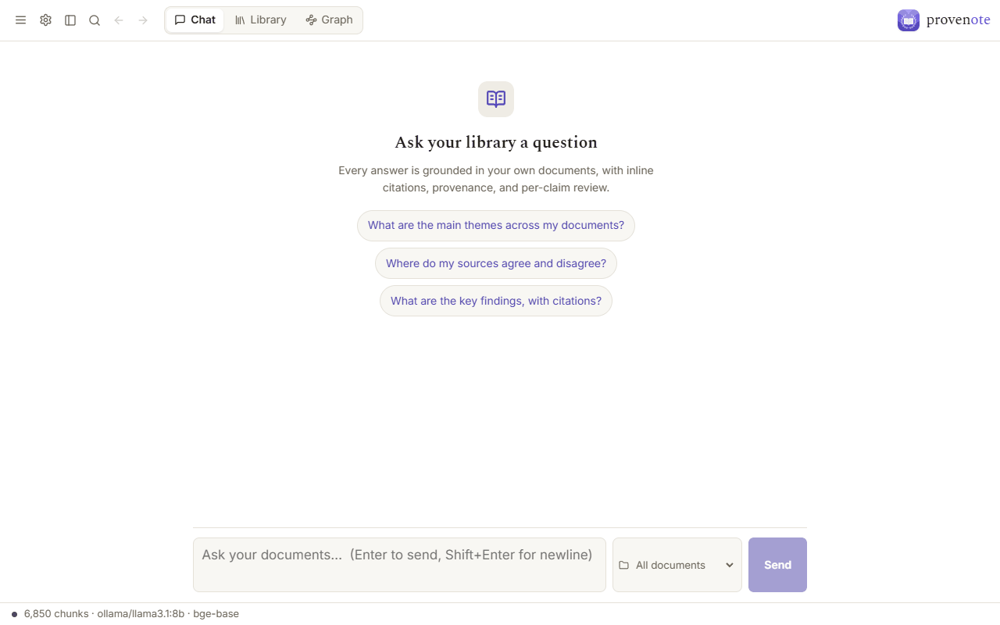
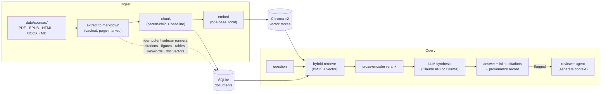

# Provenote

[](https://github.com/ldele/doc_assistant/actions/workflows/ci.yml)
[](https://github.com/ldele/doc_assistant/releases/latest)
[](LICENSE.txt)

**Ask questions of your own papers and books, and check every answer against the page it came
from.**

Provenote is a desktop app for one person and their library: a researcher, student or analyst who
needs to know where a statement came from before reusing it. It reads PDF, EPUB, DOCX, HTML,
Markdown and more, answers in prose with a citation on each claim, and keeps your library on your
disk. With a local model, nothing leaves your computer.



**[Download for Windows](https://github.com/ldele/doc_assistant/releases/latest)** ·
[Quickstart](docs/QUICKSTART.md) · [60-second walkthrough](docs/DEMO.md) ·
[How answers work](docs/how-answers-work.md)

## Why Provenote

- **A citation opens the page.** Each cited claim names the page its passage came from. One click
  shows that page of the PDF as it was printed, beside the document; *In context* shows the passage
  highlighted in the text around it.
- **What your sources say is kept apart from what the model infers.** An answer shows the retrieved
  passages word for word, with source, page and relevance score, and next to them the model's
  synthesis, labelled as interpretation. A claim that cites nothing, or cites a weak passage, is
  flagged for you to accept, reject or edit, and a separate reviewer can re-grade a flagged answer
  against the passages. The flags tell you where to look; they do not certify a claim.
- **Your documents can stay on your computer.** With a local model through
  [Ollama](https://ollama.com), none of your text leaves the machine: the embedding and reranking
  models run locally and ship in the installer. With the Claude API, only the question and the
  passages retrieved for it are sent.
- **Its quality is measured, and the measurements are published with their limits.** Every result
  below can be rebuilt from a public corpus, and the [limitations](#limitations) are written down
  with counts.

## What you can do with it

- **Ask, and read the evidence.** Streaming answers with inline citations, page numbers and every
  passage inspectable.
- **Browse your library.** A filterable grid with folders. Each document opens as five ordered
  blocks: metadata, connections, passages, figures and references, with the figures extracted from
  the paper readable at full size.
- **Add documents without leaving the app.** Drop files or a folder, pick them, or import from
  Zotero. A review sheet says what will happen to each file first, and a file you only reference is
  never moved, altered or deleted.
- **Map what your library covers.** A concept graph built from the concepts you choose, with
  definitions quoted from your own documents at their page, and gaps (a concept only one source
  covers) surfaced as leads to read next.
- **Keep your conversations.** Searchable, renameable, exportable as Markdown, with an undoable
  delete.
- **Choose your answer engine in the app.** An Anthropic API key or a local Ollama server, set in
  Settings; no file to edit.

## Get it

**Windows installer.** Download `Provenote_<version>_x64-setup.exe` from the
[latest release](https://github.com/ldele/doc_assistant/releases/latest) and run it. It is about
1.6 GB because the embedding and re-ranking models are bundled, and it runs fully offline with a
local [Ollama](https://ollama.com). It is not code-signed, so SmartScreen will warn. Settings →
Updates can tell you when a newer one is published; it never installs anything for you.

**From source** (Python 3.12 + [uv](https://docs.astral.sh/uv/)):

```bash
uv sync --extra cu130 --extra dev        # or --extra cpu on a GPU-less box
uv run python -m scripts.download_corpus --demo   # no corpus yet? 28 papers from arXiv
uv run python -m doc_assistant.ingest
just app                                 # backend + desktop UI
```

Then open **Settings → Provider & model** and pick an answer engine: paste an Anthropic API key
(checked before it is saved, stored on your machine only) or point at a local Ollama server.

A 30-page paper takes about 15 seconds to index, once; after that it is cached
([what indexing costs](docs/performance.md)). First run, step by step:
[Quickstart](docs/QUICKSTART.md). Full install, hardware and Docker: [Setup](docs/setup.md).
Everyday commands: [Usage](docs/usage.md).

## Measured, not asserted

The eval harness runs the full pipeline (retrieve, rerank, generate) over a fixed question set on a
public corpus anyone can rebuild: 10 hand-checked questions over 10 arXiv papers pinned by
checksum. 5 trials on Claude Haiku 4.5, latest run 2026-08-01, mean ± trial-mean std:

| Scorer | Mean (n=5) | Std | What it measures |
|---|---:|---:|---|
| `contains_all` (0-1) | **0.932** | 0.014 | the answer holds the facts it must hold |
| `citation_overlap` (0-1) | **1.000** | 0.000 | retrieval cited the correct paper |
| `llm_judge` (1-5) | **3.694** | 0.258 | reference-graded answer quality |

Read them as indicative. Ten papers are too few for `citation_overlap` to rank anything, so it
shows only that nothing regressed, and the `llm_judge` band means only changes above about ±0.5
would be visible. The cases are strict and none were tuned to score 1.0. The embedder comparison,
the chunk-size and weight sweeps, the caveats and the reproduction steps are in
[`evals/`](evals/README.md); speed, memory, disk and scale are in
[`docs/performance.md`](docs/performance.md).

## How it works



Retrieval is hybrid: BM25 and vector search, then a cross-encoder rerank. The
[`bge-base-en-v1.5`](https://huggingface.co/BAAI/bge-base-en-v1.5) embedder and
[`bge-reranker-base`](https://huggingface.co/BAAI/bge-reranker-base) cross-encoder both run
locally and are swappable. Chroma holds the vectors and SQLite the documents. The desktop app is
Tauri + Svelte 5 over a FastAPI/SSE backend, and there is a CLI.

Three choices shape the code:

- **Settings change only on evidence.** The embedder, the chunk sizes and the BM25/vector mix were
  each tested on the eval harness with repeated trials, and the record also says which settings
  were never tested ([`evals/`](evals/README.md), [decisions](docs/decisions.md)).
- **Growth by addition.** Every derived layer (citations, figures, tables, keywords, wiki, concept
  graph) is an idempotent sidecar that never mutates the chunk store. A new capability is a new
  module.
- **The app is a thin shell.** All logic lives in one Python library; the desktop app and the API
  only render and route.

Data flow and module contracts: [`docs/architecture.md`](docs/architecture.md).

## Limitations

The short list. Each of these, with counts and what to do about it, is in
[`docs/limitations.md`](docs/limitations.md).

- **Local models cite less.** On 27 questions, Claude Haiku 4.5 put a citation on 83.5% of its
  sentences, `llama3.1:8b` on 37.6% (one run each, measured before a fix in 0.7.0; to be
  re-measured). Uncited claims are flagged, and nothing is blocked.
- **A flag measures relevance, not truth.** An unflagged claim is not a verified claim.
- **Scanned PDFs need an OCR engine, and the app ships none.** Without `tesseract` on your PATH a
  pure-image PDF extracts to nothing and is marked *broken*.
- **Validated at about 100 documents, not thousands.** Retrieval holds and memory stays flat at
  about 2 GB; the enrichment passes are not ready for a bulk ingest of thousands.
- **Windows first.** CI also runs on Linux; macOS paths work but are unbenchmarked. The installer
  is not code-signed.
- **Single user, on localhost.** An API key entered in the app is stored in plain text in your
  data folder; `.env` takes precedence if you would rather manage it yourself.

## Status

**v0.7.1 (2026-10-31): the map of your library becomes yours to curate and check.** Concepts are
ones you take on, definitions are quoted from your documents with their page, curated work survives
a merge, and the app is harder to misuse (oversized files and zip bombs refused, answers sanitised,
a local API that takes writes only from the app). At that release: 2,816 Python tests and 317
desktop tests, ruff / mypy / bandit clean, and an installer built from the tag and installed on a
clean machine before it was published.

Next: the knowledge layer reads past the reference list, then suggestions of what to read next for
a subject, and LLM-assisted ingestion. Release notes: [`CHANGELOG.md`](CHANGELOG.md). Roadmap:
[`docs/ROADMAP.md`](docs/ROADMAP.md).

## Documentation

| | |
|---|---|
| [Quickstart](docs/QUICKSTART.md) | First run in ~10 minutes: API key or Ollama, then your documents |
| [60-second walkthrough](docs/DEMO.md) | What to look at first |
| [Project overview](docs/OVERVIEW.md) | What it is, what was measured and where it stands, each figure with its source |
| [Setup](docs/setup.md) · [Usage](docs/usage.md) | Install, hardware, Docker · commands, enrichment, tests |
| [How answers work](docs/how-answers-work.md) | Evidence/interpretation split, grounding markers |
| [Architecture](docs/architecture.md) | Data flow and module contracts |
| [Decisions](docs/decisions.md) | ADR index, and why each non-obvious choice was made |
| [Evals](evals/README.md) | Quality benchmark write-ups and reproduction |
| [Performance](docs/performance.md) | Speed, memory, disk, the trade each optimisation made, and what happens at 10x |
| [Limitations](docs/limitations.md) | Every known limit, with counts and workarounds |
| [Security](docs/security.md) | Threat model and the security floor |

Agent-facing coordination lives in `AGENTS.md`, kept separate from this README.

## License

Apache-2.0, see [LICENSE.txt](LICENSE.txt).
