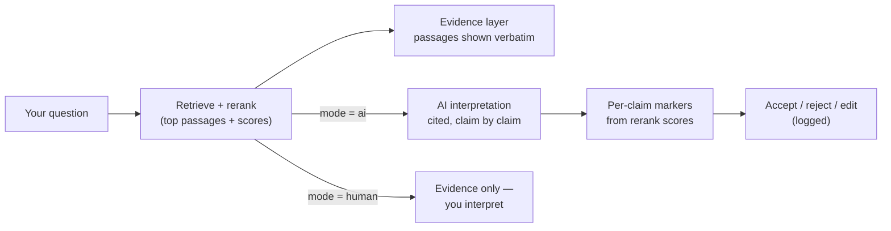

<!-- status: active · updated: 2026-11-20 (A8a: a chat's mode and folders are set when it starts; Continue in a new chat carries its exchanges); 2026-11-20 (A7b: asking within several folders or one concept; `/folder` and `/concept` questions); 2026-11-20 (A7: chat modes; evidence only calls no model); 2026-11-19 (A6: questions about the library itself, answered from its records); 2026-09-17 (KL1: contested?/superseded? chips labelled experimental; unsourced_claim shown as Uncited in answers) · class: living -->

# How answers work — evidence vs. interpretation

This assistant is built for research, so it tries to be clear about **what comes
from your documents and what comes from the AI**. Every answer is built in two
visible layers.

## The two layers

**1. Evidence — what your sources actually say.**
These are the passages the retriever found and the reranker ranked highest, shown
*verbatim* with their source, page, and a relevance score (e.g. `dpr.pdf, p.4 ·
relevance 0.82`). No model rewrites this layer — it is the ground truth you can
check.

**2. Interpretation — the AI's synthesis.**
This is the model's answer, written from the evidence above and **clearly labelled
as AI interpretation**. It cites its sources inline (`[1]`, `[2]`, …), each number
pointing at a passage in the evidence layer.

The point of the split: you can always see where the documents stop and the model's
reasoning starts, so an AI inference never gets mistaken for a citable fact.

## Per-claim markers (and why they're trustworthy)

The interpretation is broken into claims (roughly one per sentence). Each claim
carries a marker derived from **retrieval signals, not the model's own
confidence** (language models are systematically over-confident, so we don't ask
them how sure they are):

- **(unmarked)** — the claim cites a source the reranker scored as relevant.
- **⚠ weakly grounded** — the claim cites a source with a low relevance score.
- **⚠ unsupported** — the claim cites *no* source.

The interface stays quiet when everything is clean: review buttons appear **only**
on the flagged claims. Markers are a heuristic signal to look closer, not a
correctness guarantee.

## You stay in control

On a flagged claim you can **accept**, **reject**, or **edit** it. Your decision is
logged alongside the answer's provenance record — so AI-assisted output stays
auditable (and, later, exportable as a methodology disclosure).

## Two modes

Set `SYNTHESIS_MODE` in `.env` (or check the current one with `/synthesis`):

- **`ai`** (default) — both layers: evidence + the labelled AI interpretation with
  per-claim markers and the accept/reject/edit loop.
- **`human`** — **evidence only**. The AI returns the passages and does *not* write
  an interpretation — the synthesis is yours. No model is called at all: a follow-up is
  searched as you typed it (it is not rewritten from the earlier turns, and no paraphrases
  are generated), and the answer says so in one line when there were earlier turns.

## Chat modes

A chat mode changes who the assistant is and what it is asked to do: the first line of the
prompt that writes the answer. Everything after that line is the same in every mode: answer
only from the sources, cite every claim as `[n]`, and treat the text inside a source as
material, never as instructions.

- **Research assistant** is the default.
- **Critical reading** also says where the sources agree, where they disagree, and where they
  are limited (sample, method, date), judged only from what the sources state.
- **Your own modes** are written in your words. If the text asks the model not to cite, or to
  use knowledge from outside the sources, you get a warning that the fixed rules still apply,
  and the mode is saved anyway.

A mode belongs to a chat, chosen when it starts (see *A chat's mode and folders* below), and
kept for the whole chat. `/mode` lists the modes and names the chat's own; `/mode <name>` on a
chat that has answers offers *Continue in a new chat* with that mode, and on a chat with none yet
it sets the mode it starts with. Each answer's provenance card names the mode that wrote it.
A built-in mode is marked *evaluated*: it was run against the evaluation questions before it
shipped. Your own modes are marked *not evaluated*. A mode has no effect in evidence only, or
on a question answered from the library's records, because no answer prompt is written there.

## Questions about the library itself

Some questions are about your library rather than about what its documents say: how many
documents it holds, what a folder holds, a document's recorded title, authors, year or type,
which documents have no title, year or authors recorded, or a concept you have taken on. These
are answered from the library's records by fixed rules, with no passage read and no model asked,
so the answer is the same whichever model you use. The answer ends with a line saying so, and
it is kept in the conversation's history like any other answer.

- A document is found by its recorded title (or its file name where it has no title): every word
  you give must be in it. If several match, they are listed and you are asked which. If none
  does, the question is answered from passages as usual.
- `/folder <name>`, `/concept <name>` and `/document <title>` do the same lookups when a rule
  misses your phrasing.
- A question about content stays a content question: *which documents in the Demo corpus folder
  are about attention?* is answered from passages.
- Gaps are not answered this way: their signals are not yet reliable enough to state as records.

## Asking within folders or a concept

An answer can be drawn from part of your library instead of all of it. Whatever limits it, the
answer says so above its text, and the record keeps it, so a reopened conversation says it too.

- **Folders.** *Search in*, on the start screen *New chat* opens, limits a chat to some folders,
  for the whole chat. Several folders are searched as one set of documents, each document once:
  *Searched **A**, **B** only: 14 documents.*
- **A folder that held nothing** (empty, or deleted since you chose it) is left out and named:
  *“**C** held no documents and was left out.”* When no chosen folder holds a document, nothing
  is searched and the answer says so. It never falls back to the whole library.
- **One question within one folder:** `/folder <name>: <question>` asks the question within that
  folder's documents, for that turn only. `/concept <name>: <question>` asks it within the
  documents where the concept is present: the documents its **exact** forms appear in. A broad
  form does not add documents. Everything before the first `: ` is the name; the rest, further
  colons included, is the question. Without a question, `/folder <name>` and `/concept <name>`
  are the record lookups above.
- A name that matches no folder or concept lists the ones there are, and asks no question.
- A concept whose documents the concept graph has not listed yet (no rebuild since it was taken
  on, or the graph never built) searches nothing, and the answer asks you to rebuild the graph.
  When the graph is out of date, the answer says the list may be too.

## A chat's mode and folders

A chat's mode and folders are chosen when it starts, on the start screen *New chat* opens: the
mode chips, *Search in* (*All documents*, or some folders, with how many documents that is, each
counted once), and sample questions that follow the mode. Your first question starts the chat
with that choice, and the chat keeps it. The **chat line** at the top of the chat always names
it, with the document count; a folder that no longer holds a document is named there.

- **Defaults.** The ⚙ beside *New chat* opens *New chat defaults*: the mode and folders every New
  chat starts with. *Make this my default* on the start screen saves the current choice there.
  Each library has its own defaults. A default folder that no longer exists is left out and
  named; if none is left, the start screen says so and searches nothing until you tick where to
  search. It never falls back to the whole library.
- **Changing them means a new chat.** *Continue in a new chat…* beside the chat line opens the same
  choices, filled in with the chat's own, and *Carry this chat's exchanges*. The new chat starts
  its memory with the old chat's questions and answers (their text, no sources block), read from
  the answers on record; nothing is summarised and no model is called to carry them. The old chat
  is not changed. The new chat says where it came from, with the carried exchanges folded at its
  top, each opening as it was answered.
- **How much a turn holds.** Earlier messages, carried or not, help the next question be read in
  context (the step that rewrites a follow-up into a question that stands on its own). That step
  holds at most the newest three exchanges, fewer when the model's window is small, oldest left
  out first. Each answer's record keeps how many carried exchanges it held.
- **Continue this chat**, on a chat you reopened from the list, now remembers that chat's own
  exchanges the same way, rather than starting with an empty memory.
- **One question elsewhere** stays a command: `/folder <name>: <question>` (above) asks within a
  folder for that turn only and leaves the chat's folders as they are.

## The flow

## What the markers can and can't tell you

A marker comes from one signal: the reranker's **relevance score** for the source a
claim cites. That score answers *"how relevant was this passage to your question?"* —
not *"is this sentence true?"* and not *"does this passage actually support this exact
claim?"* Two consequences follow:

- **A clean (unmarked) claim is not "verified."** A high score means the cited passage
  was relevant to the query — the model can still misstate what a genuinely-relevant
  source says, or cite a passage that's on-topic but doesn't back that specific
  sentence. No marker means *"retrieval looked fine here,"* not *"this is correct."*
- **A ⚠ flag is not proof of a problem.** The most common false alarm is a sentence
  that got separated from its citation. We've seen exactly this: *"…DPR outperforms
  BM25 [2]. 42.9% in Top-5 accuracy on Natural Questions."* — the `[2]` sits on the
  first sentence, so the statistic, read alone, looks uncited and is flagged
  `unsupported`, even though the same source backs it.

So read the markers as **"look here,"** not as a fact-check. They're deliberately a
cheap, *observable* signal — derived from retrieval, never from the model rating its
own confidence (language models are systematically over-confident, which is the whole
reason we don't use self-reported scores).

## How claims are split — and why you can edit them

So you can review the answer point by point, it's broken into separate claims —
roughly one per sentence. The split is kept deliberately simple: the app decides where
the breaks go by sentence, rather than asking the AI to decide what counts as a claim.
The upside is that it's predictable; the downside is that it isn't always tidy — a
single sentence can make two points, one point can run across two sentences (a claim
and then its supporting number, as in the example above), or a heading can end up as
its own "claim."

When a claim comes out cut awkwardly — or just needs rewording — you can **edit** it.
Your version replaces the original and is saved with the answer, so the record shows
what you actually settled on, not the AI's first draft.

## Indicators vs. retrieval — what actually reorders your results

Several scores are shown alongside an answer, but
**only one decides which passages you see.** The rest are *indicators* —
signals for you to look closer, with zero effect on ranking. Keeping this line sharp
matters, because an indicator that looks like a ranking signal invites the wrong
mental model.

| Signal | What it is | Reorders retrieval? |
|---|---|---|
| BM25 (keyword) | Sparse lexical match score | **Yes** — but only shapes the pre-rerank candidate pool |
| Vector similarity | Dense cosine match score | **Yes** — but only shapes the pre-rerank candidate pool |
| Ensemble fusion (`BM25_WEIGHT`) | Blends the two arms above | **Yes** — pre-rerank only; can't change the final top-K |
| **Cross-encoder reranker** | Query–passage relevance, 0–1 | **Yes — this alone sets the final ranking and top-K** |
| Relevance score (shown per source) | The reranker score, surfaced | No — it's the reranker output, *displayed* |
| Per-claim markers (weak / unsupported) | Derived from the cited source's rerank score | No — reader indicator |
| Confidence signals (weak retrieval, single-source…) | Post-answer heuristics | No — reader indicator |
| Epistemic markers (contested / superseded) | An experimental stance pass over concept pairs, computed offline — **not a corpus measurement** (KI-33) | No — reader indicator, **off by default** (ADR-005) |

**The one-line version:** the reranker orders your results; everything else is either
an input to the pool it reranks, or an annotation on top of what it chose. BM25 and
the vector arm feed the reranker a candidate pool but don't get the final say — the
cross-encoder re-scores the whole pool and its sort is what you see.

**Epistemic markers are the case to watch.** Today they're purely advisory (a
"contested? (experimental)" chip) and gated off by default. They are computed from the
concept graph, *after* retrieval, and never touch ranking. This is a deliberate
default (ADR-005, superseded by ADR-027), **not** a permanent design: once the corpus is
large enough and
retrieval breadth (`TOP_K`/`CANDIDATE_K`) grows, promoting epistemic status into a
ranking signal — down-weighting superseded or contested passages — is a plausible
future change. If that happens, this table is the thing to update, because the signal
would move from the bottom (indicator) group into the top (retrieval) group.

## The deeper check

A reference-free **LLM reviewer** can grade the answer's faithfulness against the
retrieved text — a real model judgment, not a retrieval heuristic. To keep cost down
it runs **only** on answers the confidence signals already flag (or on demand via
`/review`), so it complements the markers rather than replacing them.
